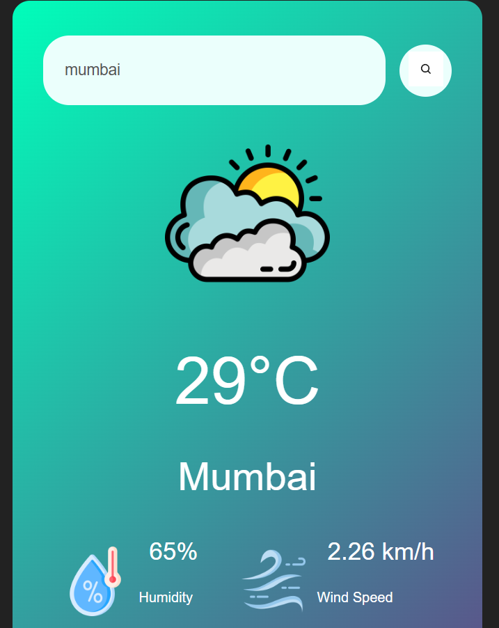

# Weather App

A simple, responsive weather app built with HTML, CSS, and vanilla JavaScript. Search any city and instantly see its current temperature, humidity, and wind speed, along with a matching weather icon.



## Features

- Search weather by city name (button click or Enter key)
- Shows temperature (°C), humidity (%), and wind speed (km/h)
- Weather icon changes with conditions (Clear, Clouds, Rain, Drizzle, Mist)
- Error message for invalid city names
- Clean gradient UI that works on desktop and mobile

## Tech Stack

- HTML5
- CSS3 (Flexbox)
- JavaScript (ES6, `fetch` and `async/await`)
- [OpenWeatherMap API](https://openweathermap.org/api)

## Project Structure

```
weather-app/
├── index.html
├── pp8.css
├── pp8.js
└── README.md
```

## Getting Started

### 1. Clone the repository

```bash
git clone https://github.com/YOUR_USERNAME/weather-app.git
cd weather-app
```

### 2. Get a free API key

1. Create an account at [openweathermap.org](https://home.openweathermap.org/users/sign_up).
2. Go to **My API keys** in your account dashboard.
3. Copy your key. Note: a new key can take up to a couple of hours to activate.

### 3. Add your key

Open `pp8.js` and replace the placeholder on the first line with your own key:

```js
const apiKey = "YOUR_API_KEY";
```

### 4. Run the app

Open `index.html` in your browser, or use a local server such as the VS Code **Live Server** extension.

## How It Works

The app calls the OpenWeatherMap **Current Weather Data** endpoint:

```
GET https://api.openweathermap.org/data/2.5/weather?q={city}&units=metric&appid={API key}
```

| Parameter | Description |
|-----------|-------------|
| `q`       | City name (URL-encoded) |
| `units`   | `metric` returns temperature in °C and wind speed in m/s |
| `appid`   | Your API key |

## Note

The API key in this repository is a placeholder, so the app will not return data until you add your own key. This project was built for practice and is shared so people can read the code.

## Future Improvements

- Use the browser's location to show local weather on load
- 5-day forecast
- Celsius / Fahrenheit toggle
- More weather icons (Snow, Haze, Thunderstorm)

## Acknowledgements

- Weather data from [OpenWeatherMap](https://openweathermap.org/)
- Icons from [Flaticon](https://www.flaticon.com/)